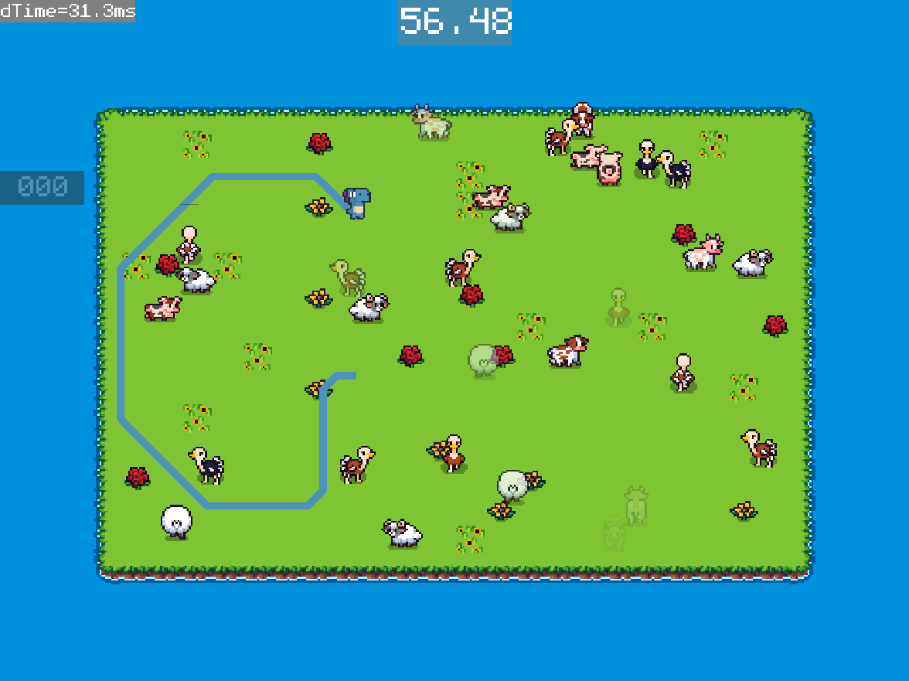

# Projet DinoRanch

A partir de maintenant, nous travaillerons sur un même projet : "DinoRanch".

DinoRanch est un projet de jeu 2D d'arcade de 1 à 4 joueurs en local.
Le jeu est en vue du dessus. Les joueurs incarnent chacun un dinosaure.
Les dinosaures doivent capturer des animaux en tournant autour.
Les animaux capturés donnent des points. Plus la prise est grosse, plus il y a de points.
La partie s'arrête quand le chronomètre arrive à sa fin, et les points sont décomptés.

## 1. Prise en main

Dans l'explorateur de solutions, à droite, clic-droit sur "Dino",
puis clic sur "Définir en tant que projet de démarrage / Set as Startup Project".

Compiler et lancer le projet ; vous devriez avoir des animaux qui apparaissent
et se déplacent vers l'extérieur de l'écran.

A) Dans l'explorateur de solutions, à droite, clic-droit sur "Documentation",
puis clic sur "Générer / Build". Ensuite, ouvrir l'explorateur de fichiers,
et ouvrir le fichier `docs/html/index.html` (avec un navigateur Internet).

B) Dans la documentation, dans l'onglet "Espace de nommage", cliquer sur "Liste des espaces de nommages".
Puis cliquer sur le namespace `dino`. Parcourir la page pour prendre connaissance de ce qui est déjà fourni.
Quelles classes sont déjà définies et que font-elles ?

> Animal : Gère indépendamment le cycle de vie de chaque animal (initialisation et gestion des ressources, logique de déplacement, animation et affichage)  
Scene : met à jour la logique de la scène et des animaux présent dans la scène par des appels. Génére de nouveaux animaux de manière périodique.  
Terrain : gére l'affichage, l'animation et le changement de saison du terrain où les entités se déplacent. Peut générer une position aléatoire dans l'espace du terrain ou restreindre une position existante sur celui ci.

C) Lancer le programme en configuration "Debug", attendre quelques secondes,
puis mettre un point d'arrêt (= breakpoint) à la fin de `jv::game::Draw()`
(sur la ligne de l'accolade fermante). Dans la fenêtre "Espion 1 / Watch 1",
regarder "g_rdr". Combien de vertex buffers y a-t-il, et de quels types ?
Combiend de textures y a-t-il, et de quels types ?

> Il y a 37 vertex buffers de type jv: :gpu: :VertexBuffer (un pour le terrain, un pour afficher le delta time et un pour chaque animal).  
Il y a 38 textures de type jv: :gpu: :Texture (white, terrain.bmp, monogram-bitmap.bmp et plusieurs animals.bmp)

D) Dans `dino_animal.cpp`, que veut dire la syntaxe `dino::Animal::~Animal()` ?
Mettre un breakpoint dans cette fonction, puis une fois le programme en pause,
afficher la fenêtre "Pile d'appel / Callstack" en bas.
Qui appelle cette méthode ? Si besoin, clic-droit > "Show external code"

> C'est le destructeur de la classe Animal.   
Il est appelé lors de la destruction d'une instance d'Animal; juste avant que son allocation en mémoire ne soit libéré.  
>
>Actuellement, il n'est appelé que dans un contexte :  
Fermer la fenetre de jeu -> appelle game: :Shut() -> appelle le destructeur de g_pDinoScene_ -> détruit son attribut std: :deque< Animal > m_animals -> le destructeur de std: :deque appelle le destructeur de chaque Animal qu'il contient

E) Dans `dino::Scene::_UpdateAnimals()`, dans la syntaxe `for (Animal& animal : m_animals)`,
enlever l'esperluette `&`. Quel impact cela a-t-il et pourquoi ?

> Aucun animal n'aparait à l'écran.  
Sans l'esperluette, la boucle for range crée et manipule une copie temporaire de chaque animal de m_animals lors de ses itérations.  
Les animaux d'origines (ceux qui sont affichés) n'effectuent donc jamais leur Update. Ce qui veut dire pas de déplacement et pas de Fade In.  
Cela explique pourquoi ils sont invisibles.  
Grâce à l'esperluette, la boucle for range va manipuler des références (en interne, ce sont les adresses mémoires des animaux). L'objet qui recevra l'appel de l'Update sera donc l'animal d'origine et non une copie.

F) Comment prévenir cette erreur à la compilation ? Quelle bonne pratique est associée à cela ?

> Pour éviter que ce type d'erreur ne s'immisce silencieusement dans notre code, on peut supprimer explicitement le constructeur par copie de Animal.  
Cela permet de respecter la sémantique d'entitée. Chaque Animal est conceptuellement une entitée distincte; donc défini par son identitée plus que par son contenu. Selon la logique de jeu, il ne devrait donc jamais etre duppliqué.  
Pour aller plus loin, on pourrait aussi appliquer la régle de 3 qui dit que :  
Si on doit expliciter un de ces 3 membres; alors il vaut mieux expliciter les 3. (constructeur par copie, opérateur d'assignation par copie, destructeur)

Remettre l'esperluette.

G) Comment faire pour qu'il n'y ait qu'une unique texture `animal.bmp` chargée en VRAM ?
Le faire.

> Actuellement, chaque Animal charge la texture et gére sa durée de vie comme si elle n'était utilisée que par lui. A cause de cela, des copies de la texture s'accumulent en VRAM et crée des fuites de mémoires.  
Pour remédier à cela, on met en place une injection de dépendance.  
La scène est unique, survi à l'ensemble de la partie et génére les animaux; ça sera donc elle qui chargera la texture une unique fois et gérera son cycle de vie.
Lors de la créaction des animaux, on injectera la référence à cette texture par leur constructeur.

H) Dans `dino::Animal::Draw()`, à quoi servent les coordonnées `uv` des `jv::gpu::Vertex` ?

> Ce sont des coordonnées interprétés par le GPU. Elles établissent une correspondance entre chaque vertex et son emplacement sur la texture.  
Dans Animal::Draw(), elles sont utilisés pour faire varier le visuel des animaux tout en utilisant une unique texture.  
Selon les coordonnées sur la texture, un animal différent et une frame d'animation différente sera affiché.  
Cela est organisé de maniére cohérente pour que cette unique texture permette d'identifier et d'animer chaque animal de manière logique.

I) Faire en sorte que les animaux aient la tête vers la droite quand ils se déplacent vers la droite,
en mettant leurs sprites en miroir.

J) Appliquer les animations de mouvement vers le haut et vers le bas quand les animaux
se déplacent principalement verticalement.
Pour modifier les coordonnées UV, se référer à [dino_uv_ref.md](dino_uv_ref.md)

## 2. Joueurs

A) Créer deux nouveaux fichiers sources `src/dino/dino_player.h` et `src/dino/dino_player.cpp`. 
Pour cela, suivez ce guide :

1. Clic-droit sur "Dino" depuis la fenêtre "Explorateur de solutions / Solution Explorer"
2. Clic sur "Ajouter / Add" puis "Nouvel élément / New element..."
3. Sélectionner "Fichier C++ (.cpp)" ou "Fichier d'en-tête (.h)"
4. Changer le nom du fichier en bas de la fenêtre
5. **IMPORTANT: Changer le chemin du fichier en cliquant sur "Parcourir / Browse" puis en
   sélectionnant `src/dino`. SINON VOTRE FICHIER NE SERA PAS SAUVEGARDE SUR GIT !**
6. Clic sur le bouton "Ajouter / Add"

Nous allons maintenant implémenter les joueurs.

B) Créer une classe `dino::Player` sur le même modèle que `dino::Animal` (copié-collé),
Instancier un `dino::Player` dans `dino::Scene`.

C) Modifier la méthode `dino::Player::Update()` pour que `m_dir` s'adapte
aux variables membres `dpad` du gamepad. Prendre en inspiration le code
de l'exercice 1 qui s'occupait de faire monter ou descendre le joueur.

D) Ajouter un bouton de sprint ; doubler la vitesse de déplacement
quand `btn_right` est appuyé (D sur le clavier).

E) Modifier la méthode `dino::Player::Draw()` pour afficher le sprite du joueur
dans la bonne direction et avec la bonne animation.
Là encore, se référer à [dino_uv_ref.md](dino_uv_ref.md)

F) Faire en sorte que lorsqu'on appuie sur le `btn_left` (Q sur le clavier),
le dinosaure se prend un dégât (= immobilisation 3 secondes + animation).

G) Modifier le code pour avoir 4 dinosaures affichés à l'écran,
déplaçable avec des périphériques différents (clavier, manette 1, manette 2, manette 3).

## 3. Physique du jeu

A) Implémenter : "Les dinosaures ne peuvent pas sortir des limites du terrain."

B) Implémenter : "Les animaux ne peuvent pas sortir des limites du terrain.
Quand ils atteignent le bord du terrain, ils prennent une nouvelle direction aléatoirement."

C) Comment détecter si deux cercles à des positions données sont en collision ?

> On considère deux objets physiques en forme de cercle :  
	- d'origine (et centre) C1 et C2  
	- de rayon R1 et R2
>
> Ces deux objets sont en collision si: distance(C1,C2) < R1+R2

D) Comment repousser deux cercles en collision de façon minimale et qu'il ne soient plus en collision ?
Quel cas particulier n'est pas résoluble ?

> On calcule la distance de pénétration P entre les deux cercles tel que :  
P = (R1+R2) - distance(C1,C2)  
>
> On déplace C2 d'une distance de P/2 dans la direction du vecteur (C1,C2)  
et C1 d'une distance de P/2 dans la direction du vecteur (C2,C1)  
Ainsi, les deux cercles s'éloignent l'un de l'autre de façon minimale.
>
> Attention! Si C1 et C2 ont la même position, il est mathématiquement impossible de définir dans quelle direction repousser les cercles.  
Au moment de normaliser le vecteur directeur (C1,C2), on devra le diviser par sa longueur; qui est ici de 0. La division par 0 est indéfini.

E) Implémenter : "Quand les dinosaures sont en collision (distance < 16 pixels), ils se repoussent."

F) Implémenter : "Les animaux se repoussent entre eux, et aussi les animaux et les dinosaures entre eux."
Pourquoi y a-t-il duplication de code ?

> Player et Animal sont deux types différents et non interchangeables pour le compilateur.  
Il y a une duplication du code car il faut créer la même gestion de colision avec en paramétre 2 joueurs, 2 animaux et 1 joueur/1 animal.  
Sauf si on utilise un template MAIS le template va dupliquer le code à notre place avant la compilation.

G) Quelle fonctionnalité du C++ permet de dédupliquer la logique commune entre `dino::Player` et `dino::Animal` ?
L'appliquer dans la base de code.

> Il faut utiliser l'héritage. On donnera à Player et Animal la même classe parent qui encapsule leurs comportements et états commun.

H) Quelle fonctionnalité du C++ permet de gérer différemment un point de logique commune,
comme la réaction à un événement du type "limite du terrain" ? L'appliquer dans la base de code.

> On utilisera la redéfinition de méthode virtuelle grâce au mot clef override.

I) Quelles méthodes de classes pourraient être mises en commune suivant le même principe ?
L'appliquer dans la base de code.

> Par exemple, Update et Draw qui ont une logique commune avec beaucoup de classes du jeu.

J) Implémenter : "Les dinosaures et les animaux sont affichés les uns derrière les autres, suivant leur position verticale."
Cela implique de trier un tableau qui peut contenir à la fois des DinoPlayer et des DinoAnimal. Comment faire ?

> On crée un tableau de pointeur vers leur parent. Ainsi, on peut contenir un accès homogène vers des instances de ces deux classes.

## 4. Programmation des lassos

A) Implémenter : "Des suites de points sont dessinées correspondant aux positions passées"
des dinosaures, aux couleurs des dinosaures.

B) Implémenter : "Les suites de points sont tronquées à une longueur maximale de deux secondes."
Quelle méthode de std::vector utiliser ?

> ‍On utilisera std: :vector: :erase.

C) Implémenter : "Quand deux segments se coupent et sont du même joueur, la boucle est retirée du lasso"
(mais la partie avant la boucle existe toujours). Combien d'intersections de segments sont calculés (en comptant les 4 joueurs) ?

> On suppose que chaque joueur ai son lasso à la taille maximale :  
nombre total d'intersections = 4 * (N-2), avec N le nombre de segment d'un lasso. 
(N-2 car on part du segment le plus récent pour vérifier les intersections; donc on ne le vérifie pas avec lui même ni son voisin direct pour éviter les fausses intersections liés à la continuité)

D) Implémenter : "Quand un joueur passe par dessus le lasso d'un autre joueur, le début du lasso est détruit jusqu'à l'intersection."
Faire en sorte que les instances de la classe DinoPlayer n'ont pas besoin d' interagir entre elles.

E) Comment détecter qu'une position est à l'intérieur d'un contour fermé définis par des segments ?

‍On lance un raycast; on regarde ensuite son nombre d'intersection avec les segments d'un polygone.  
Si le résultat est impair, le point est dans le polygone.  
Si le résultat est pair, le point n'est pas dans le polygone.

F) Implémenter via une logique commune, comme mentionné dans (3.H) : 
- Quand un dinosaure est dans une boucle de lasso, il se prend des dégâts (= immobilisation 3 secondes + animation).
- Quand des animaux sont dans une boucle de lasso, ils disparaissent.

**Fin de la partie dirigée du projet, continuer en autonomie sur `dino_cahier_des_charges.md`**

